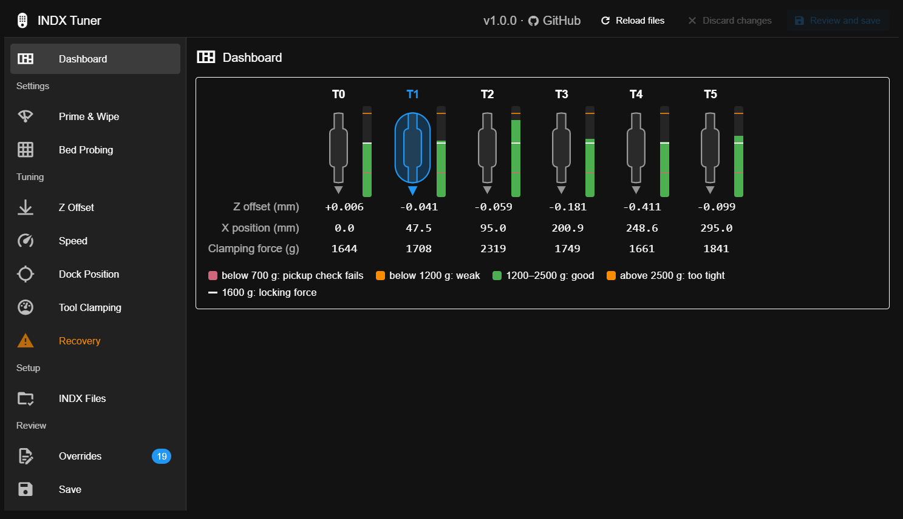
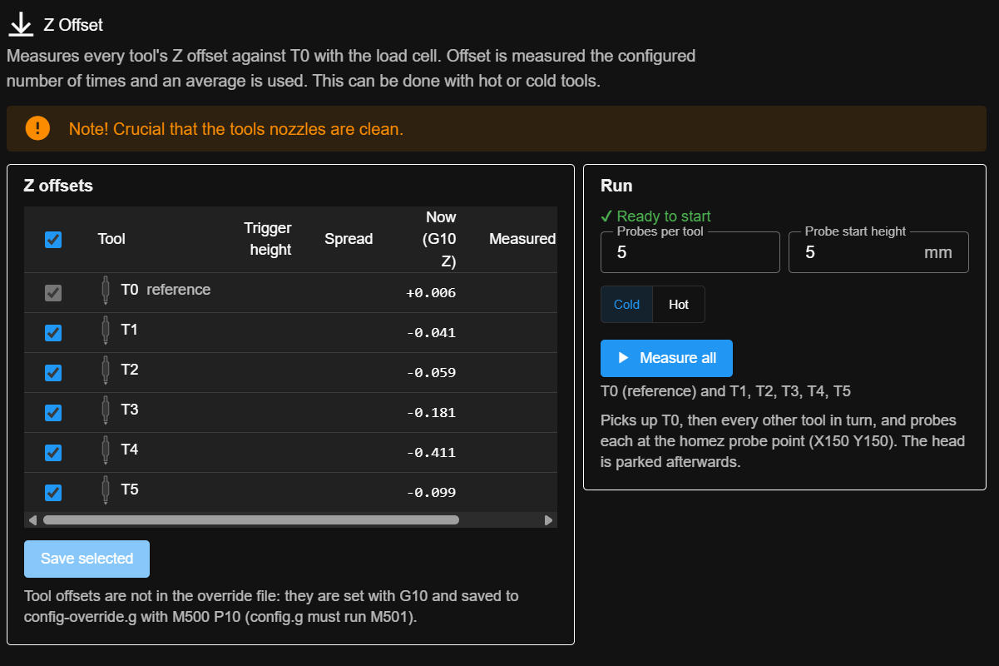
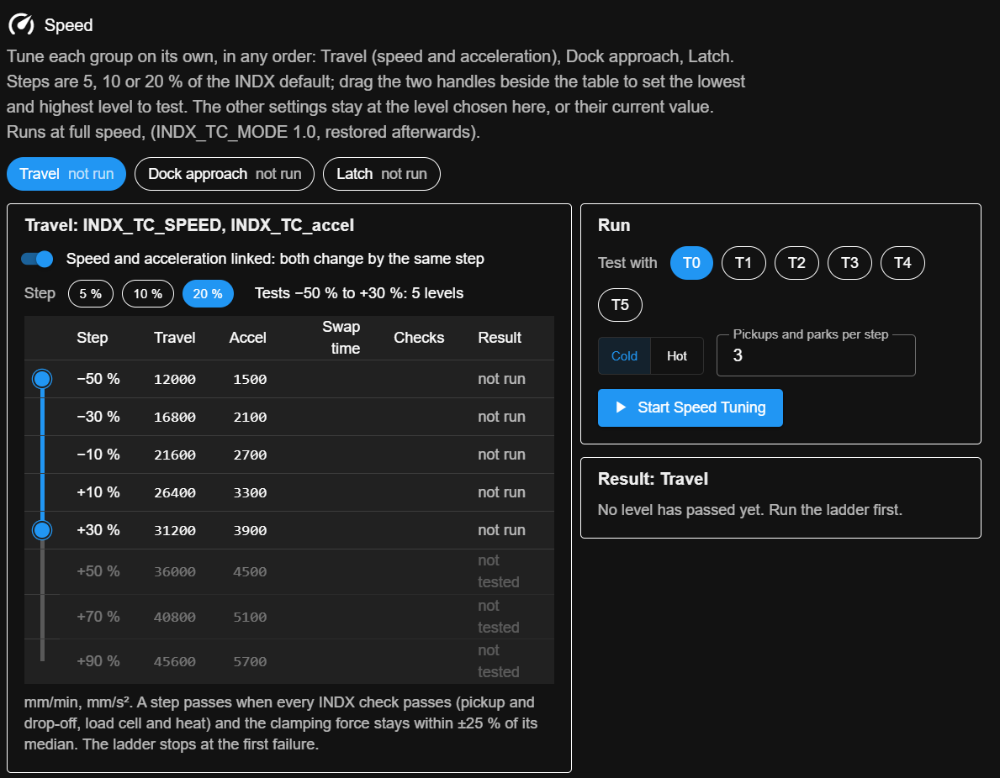
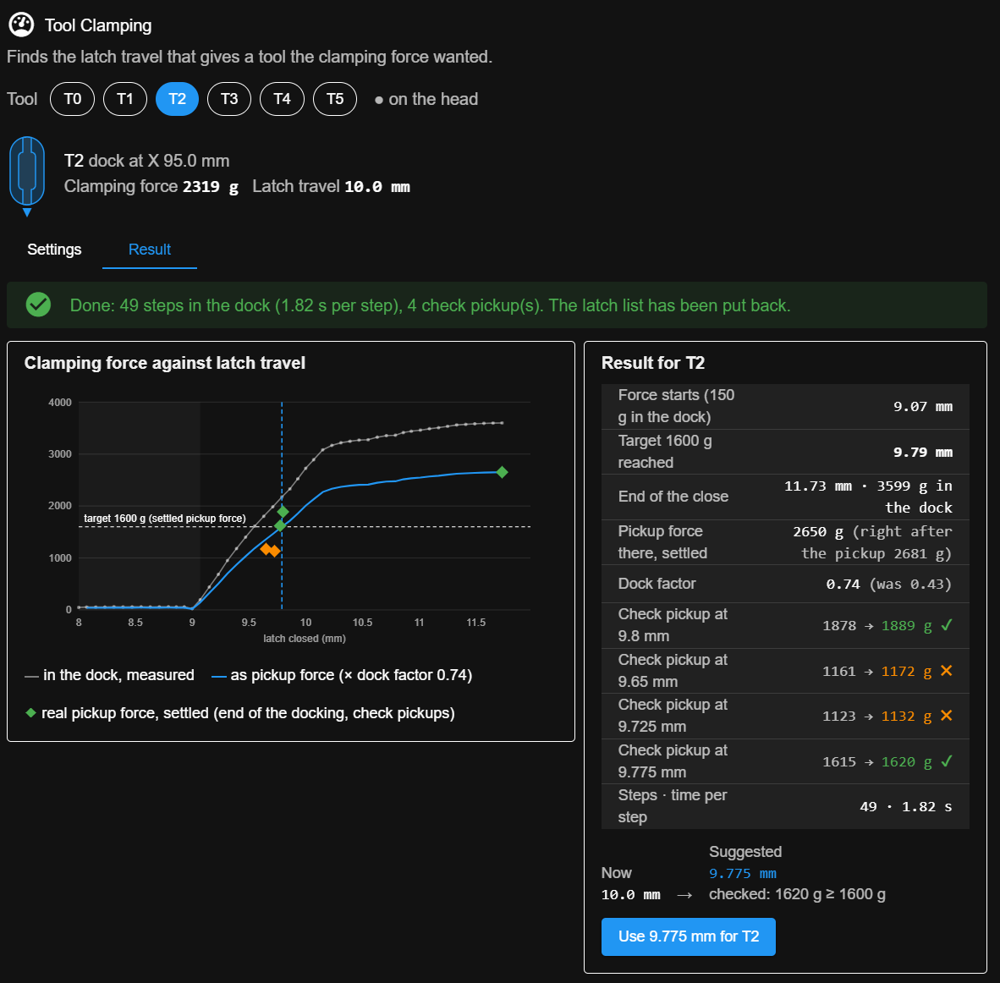

# INDX Tuner

A DuetWebControl 3.7 plugin for setting up and tuning the INDX tool changer on RepRapFirmware 3.7.

> **Beta.** Version 1.0.0 is tested on one printer (RatRig, Duet 3 Mini 5+, RRF 3.7.0, six tools).
> Moves near the docks and the clamp are made by the plugin; stay at the printer while you use it.

## What it does

- **Dashboard** – a to-do list of what still needs attention: load cell calibration, dock positions,
  clamping force, latch travel, Z offsets, mesh points outside the print area and more. When
  everything is fine it stays out of the way.
- **Prime & wipe** – settings for priming and wiping the nozzle after a tool change.
- **Bed probing** – settings for probing the bed.
- **Z offset** – measures the Z offset of the selected tools against T0.
- **Speed tuning** – tests tool change speeds over an adjustable range.
- **Dock position** – slow approach with reduced motor current, nudging at the dock, and a
  dock/undock test.
- **Tool clamping** – measures the clamping force per tool with the load cell and suggests a latch
  setting.
- **Recovery** – helps get the head back to a known state after a failed tool change.
- **INDX files** – checks the macro files against the official release, and can apply optional
  patches (with a backup, and a revert back to the official files).
- **Overrides** – everything you have changed. Changes are kept apart from the official files, and
  only what differs from the defaults is saved.
- **Save** – review your changes before they are saved.

<table>
  <tr>
    <td width="33%"></td>
    <td width="33%"></td>
    <td width="33%"></td>
  </tr>
  <tr>
    <td align="center">Z offset</td>
    <td align="center">Speed tuning</td>
    <td align="center">Tool clamping</td>
  </tr>
</table>

The plugin does not change the printer's main configuration; that is covered by the official INDX
setup instructions.

## Requirements

- DuetWebControl 3.7 and RepRapFirmware 3.7
- The official INDX macro files installed in `0:/sys`

## Install

1. Download `IndxTuner-1.0.0.zip` from [Releases](https://github.com/fotomas/INDXTuner/releases).
2. In DWC open **Settings → Plugins → External plugins → Install plugin** and choose the zip.
3. Start the plugin and open **Plugins → INDX Tuner**.

## More

- [DESIGN.md](DESIGN.md) – how the files are read and written

## Licence

GPL-3.0-or-later. See [LICENSE](LICENSE).
